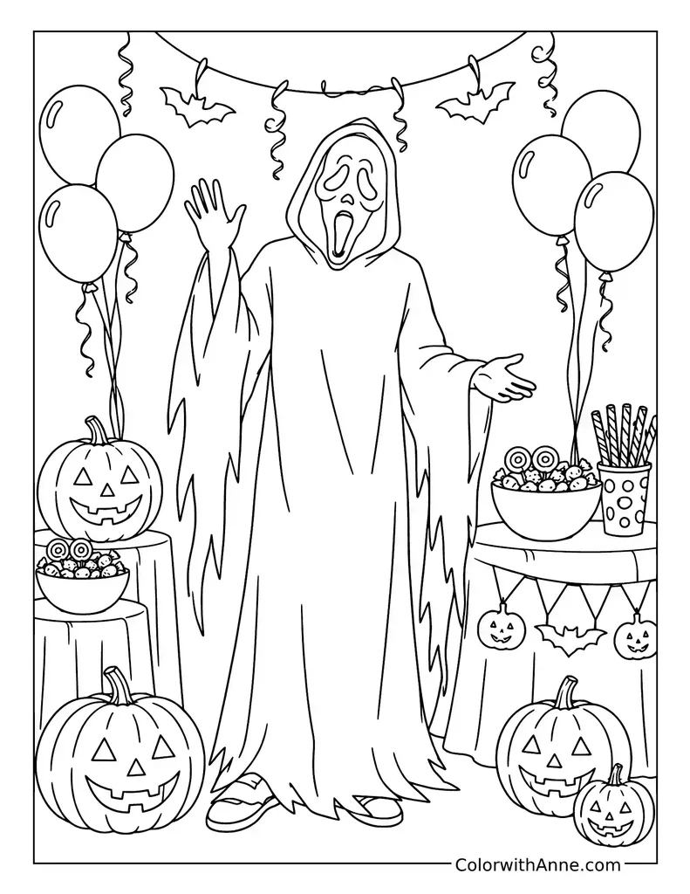
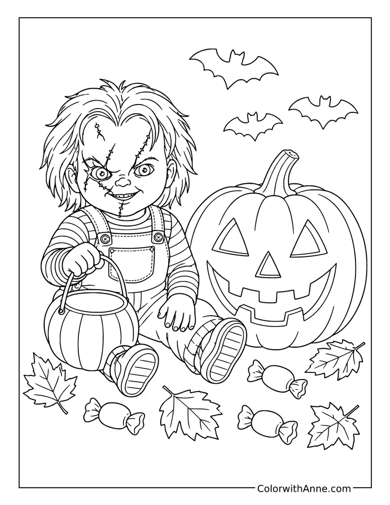
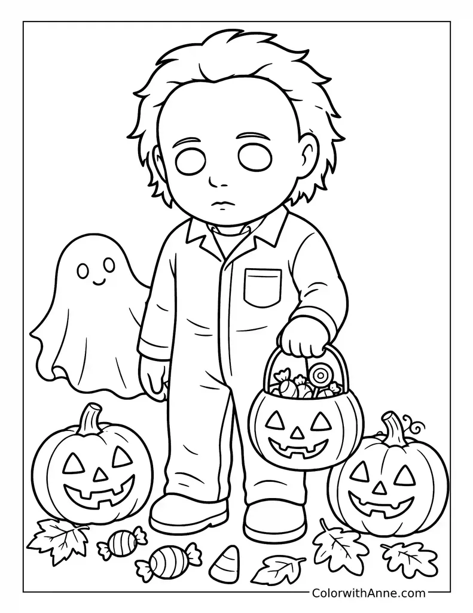

# Color with Anne: Free Printable Coloring Pages

[Color with Anne](https://colorwithanne.com/) is a growing library of free
printable coloring pages for children, parents, teachers, and anyone who enjoys
a quiet creative activity. The website brings together animal, holiday,
popular-interest, and everyday themes with clear previews and easy access to
printable PDF pages.

This repository is the official lightweight preview catalog for the website.
It documents selected collections, recent additions, accessible image
descriptions, and reusable metadata without duplicating the print-quality PDF
library.

[Explore Color with Anne](https://colorwithanne.com/) |
[Browse the preview catalog](https://imakingtan.github.io/color-with-anne-printable-coloring-pages/)

## About Color with Anne

Color with Anne is designed to help visitors:

- Find themed coloring activities for home, classrooms, parties, and quiet time.
- Preview a drawing before choosing what to print.
- Explore both simple scenes and more detailed compositions.
- Print on standard US Letter or A4 paper from the official topic pages.

The maintained website is the authoritative source for downloadable files,
usage guidance, and the newest coloring-page collections.

## New This Week

_Last updated: October 28, 2026_

<p align="center">
  <a href="https://colorwithanne.com/romance-saja-coloring-pages/"></a>
  <a href="https://colorwithanne.com/mystery-saja-coloring-pages/"></a>
</p>
<p align="center">
  <a href="https://colorwithanne.com/abby-saja-coloring-pages/"></a>
  <a href="https://colorwithanne.com/meowth-coloring-pages/"></a>
</p>
<p align="center">
  <a href="https://colorwithanne.com/jigglypuff-coloring-pages/"></a>
  <a href="https://colorwithanne.com/aphmau-coloring-pages/"></a>
</p>

- [Romance Saja Coloring Pages (Free PDF Printables)](https://colorwithanne.com/romance-saja-coloring-pages/)
- [Mystery Saja Coloring Pages (Free PDF Printables)](https://colorwithanne.com/mystery-saja-coloring-pages/)
- [Abby Saja Coloring Pages (Free PDF Printables)](https://colorwithanne.com/abby-saja-coloring-pages/)
- [Meowth Coloring Pages (Free PDF Printables)](https://colorwithanne.com/meowth-coloring-pages/)
- [Jigglypuff Coloring Pages (Free PDF Printables)](https://colorwithanne.com/jigglypuff-coloring-pages/)
- [Aphmau Coloring Pages (Free PDF Printables)](https://colorwithanne.com/aphmau-coloring-pages/)

These links point to the newest topic pages on Color with Anne. Their images and
printable files remain on the official website rather than being copied into
this repository.

## Trending Now

_What visitors are searching for this week. Every link goes to a real article
on colorwithanne.com._

<p align="center">
  <a href="https://colorwithanne.com/rumi-coloring-pages/"></a>
  <a href="https://colorwithanne.com/cinnamoroll-coloring-pages/"></a>
</p>
<p align="center">
  <a href="https://colorwithanne.com/minecraft-coloring-pages/"></a>
  <a href="https://colorwithanne.com/kpop-demon-hunters-coloring-pages/"></a>
</p>

- [Rumi Coloring Pages (Free PDF Printables)](https://colorwithanne.com/rumi-coloring-pages/) — impressions up 2,213 in 28 days, the site's breakout search theme
- [Cinnamoroll Coloring Pages (Free PDF Printables)](https://colorwithanne.com/cinnamoroll-coloring-pages/) — impressions up 279, ranking 5.1
- [Minecraft Coloring Pages (Free PDF Printables)](https://colorwithanne.com/minecraft-coloring-pages/) — impressions up 238 and climbing
- [KPop Demon Hunters Coloring Pages (Free PDF Printables)](https://colorwithanne.com/kpop-demon-hunters-coloring-pages/) — 515 impressions and rising fast

## Featured preview collection: Halloween

The current featured preview theme in this repository is **Halloween Coloring
Pages** — ten spooky scenes picked for the October 31 season: Ghostface,
Chucky, Michael Myers, skeletons, and a chibi witch.

[View the Halloween preview gallery](https://imakingtan.github.io/color-with-anne-printable-coloring-pages/#sheets) |
[Get the official printable PDFs](https://colorwithanne.com/halloween-coloring-pages/)

<p align="center">
  
  
  
</p>

The ten scenes are Ghostface Halloween Party, Ghostface in a Pumpkin Patch,
Classic Ghostface Full-Body Portrait, Chucky with Pumpkin and Candy, Classic
Chucky Portrait, Cute Michael Myers Halloween, Michael Myers Halloween Night,
Cute Skeleton Astronaut, Friendly Pirate Skeleton and Treasure Chest, and
Chibi Halloween Witch.

## Halloween Topics

_Representative Halloween pages for the October 31 season. Every link goes to a real article on colorwithanne.com._

<p align="center">
  <a href="https://colorwithanne.com/halloween-coloring-pages/"></a>
  <a href="https://colorwithanne.com/jack-skellington-coloring-pages/"></a>
</p>
<p align="center">
  <a href="https://colorwithanne.com/hello-kitty-halloween-coloring-pages/"></a>
  <a href="https://colorwithanne.com/bluey-halloween-coloring-pages/"></a>
</p>

- [Halloween Coloring Pages (Free PDF Printables)](https://colorwithanne.com/halloween-coloring-pages/)
- [Jack Skellington Coloring Pages (Free PDF Printables)](https://colorwithanne.com/jack-skellington-coloring-pages/)
- [Hello Kitty Halloween Coloring Pages (Free PDF Printables)](https://colorwithanne.com/hello-kitty-halloween-coloring-pages/)
- [Bluey Halloween Coloring Pages (Free PDF Printables)](https://colorwithanne.com/bluey-halloween-coloring-pages/)

These links point to Halloween topic pages on Color with Anne. Their images and printable files remain on the official website rather than being copied into this repository.

## Why this repository uses previews

This project deliberately publishes branded, web-sized WebP previews rather
than duplicate PDF files. This keeps the repository quick to browse and
preserves the official Color with Anne topic page as the single source for
print-quality downloads.

Each preview is approximately 900 pixels wide. For clean A4 or US Letter
printing, use the PDFs linked from the official topic page.

The published gallery consists of static HTML and CSS and loads no analytics or
trackers.

## Repository structure

```text
.
|-- catalog/
|   `-- coloring-pages.json
|-- docs/
|   |-- assets/coloring-pages/halloween/
|   |-- index.html
|   |-- print-guide.html
|   `-- styles.css
|-- schema/
|   `-- coloring-page.schema.json
|-- ARTWORK-LICENSE.md
|-- CONTRIBUTING.md
`-- LICENSE
```

## Metadata format

Each catalog entry describes a scene without relying on its file name alone.
The fields cover theme, subject, preview path, accessibility text, official
source page, and licensing.

Validate or adapt the format using
[`schema/coloring-page.schema.json`](schema/coloring-page.schema.json). The
schema is designed as a practical starting point rather than a formal industry
standard.

## Use and attribution

- Source code and technical documentation: [MIT License](LICENSE)
- Coloring artwork and preview images: [Color with Anne artwork license](ARTWORK-LICENSE.md)

The artwork may be printed for personal and classroom non-commercial use. It
may not be sold, republished as a collection, or used to populate another
website.

## Project principles

1. Useful to people before search engines.
2. Original, family-friendly artwork with clear ownership.
3. Fast pages with no advertising, analytics, accounts, or trackers.
4. Descriptive titles and alt text rather than keyword repetition.
5. Reviewed previews instead of duplicated print-quality files.

## More coloring activities

Browse the maintained printable collection at
[colorwithanne.com](https://colorwithanne.com/), or go directly to the
[official Halloween coloring pages](https://colorwithanne.com/halloween-coloring-pages/).

